# Voice Chat

Real-time voice calls between a customer and a support agent, in the browser.

- Backend: Node.js, Express, Socket.io
- Frontend: React (Vite)
- Voice: WebRTC, with Socket.io for signaling

Demo video: _(add link)_


## Setup

Needs Node 20.19+ or 22.12+ (Vite 8 doesn't run on older versions). With nvm, `nvm use` picks up the version from `.nvmrc`.

```bash
npm install
npm run dev
```

This starts the server on port 3001 and the React app on http://localhost:5173. Vite proxies `/socket.io` to the server.

To make a call:

1. Open http://localhost:5173 and join as an **Agent**.
2. Open it again in another tab (or another browser) and join as a **Customer**.
3. On the customer side click **Call support** and allow the microphone.
4. On the agent side click **Accept**.

If both tabs are on the same computer, use headphones. Otherwise the mic picks up the speakers and you get feedback.

### Production build

```bash
npm run build
npm start
```

Server and frontend are both served from http://localhost:3001.

### Two devices

Browsers only allow microphone access on https or localhost, so opening `http://<your-ip>:3001` on a phone won't work. A tunnel gets around that:

```bash
npm run build && npm start
cloudflared tunnel --url http://localhost:3001   # or ngrok http 3001
```

Then open the https URL it prints on both devices.

### Environment variables

- `PORT`: server port (default 3001)
- `GRACE_MS`: how long a disconnected user has to come back before their call ends (default 10000)
- `VITE_STUN_URLS`: comma separated STUN servers (defaults to Google's)
- `VITE_TURN_URL`, `VITE_TURN_USERNAME`, `VITE_TURN_CREDENTIAL`: optional TURN server, set when building the client

## Tests

```bash
npm test          # server tests
npm run test:e2e  # end-to-end test in headless Chrome
```

The server tests connect real Socket.io clients to the server. They cover the queue, accept and decline, two agents accepting the same customer, signaling, chat, mute, hanging up, refresh and rejoin, the grace period running out, duplicate tabs and invalid requests.

The e2e test builds the client and runs two Chrome instances with fake microphones through a whole call:

- queueing and accepting
- checking that audio packets actually arrive on both sides
- chat and mute
- refreshing mid-call
- ending the call and closing a tab
- a blocked microphone
- the mobile layout
- the server going down and coming back

It needs Chrome installed (or `CHROME_PATH` set). `SCREENSHOTS=1 npm run test:e2e` regenerates the screenshots below.

## Features

Required:

- Customer and Agent roles, chosen when joining
- Customer starts a call, the agent accepts, and both can hear each other
- Connection status (connecting, connected, reconnecting, disconnected)
- Mute, unmute and end call
- Shows who you're talking to and the call duration
- Text chat during the call, with name, role and time on each message
- If one person leaves, the other sees "Call Ended"
- Refreshing the page rejoins the same call, keeping the chat history and timer
- Error messages for a blocked or missing mic, a page not on https, the server being unreachable, audio failing to connect, and the other person disconnecting

Extra:

- A queue of waiting customers with Accept / Decline. Several agents can be online; the first to accept gets the call.
- Audio level indicators for both sides
- If the audio connection fails it retries automatically twice, then shows a Retry button
- Without a mic you can still join and hear the other person
- If the same session is open in two tabs, the newer tab takes over
- Tab title shows incoming calls for agents
- Works on phone screen sizes, has a dark mode

## How it works

**Server** (`server/src`): users, the queue and active calls are kept in memory. Every time a client connects (first load, refresh, or reconnect after a network drop), the server sends it a `session:state` snapshot. The snapshot holds the client's status, its current call, the chat history and the call start time. The client renders from that, which is what makes refresh work.

**Calls:** when an agent accepts, the server creates the call and sends `webrtc:start` to both sides. The agent always creates the offer. The offer, answer and ICE candidates are relayed through the server with `webrtc:signal`. Audio goes directly between the two browsers. Each negotiation has an id, so signals from an old connection are ignored after a reconnect.

**Chat** goes through the server instead of a WebRTC data channel, so the history is still there after a refresh. Message timestamps come from the server.

**Disconnects:** each tab stores a random `clientId` in sessionStorage. sessionStorage survives a refresh but is separate per tab, so two tabs act as two users. When a socket disconnects, the server waits 10 seconds before ending the call, and the other person sees a countdown. If the tab reconnects with the same `clientId` in time, it goes back into the call and both sides set up a new WebRTC connection. End call and sign out end the call immediately.

**Client** (`client/src`): the socket listeners and the WebRTC code are plain JS modules (`lib/session.js` and `lib/media.js`). React components read their state with `useSyncExternalStore`.

### Socket events

| Event | Direction | What it's for |
|---|---|---|
| `session:state` | server to client | full state, sent on every connect |
| `queue:join`, `queue:leave` | client to server | customer starts / cancels a call |
| `queue:update`, `queue:status` | server to client | waiting list for agents, queue position for customers |
| `call:accept`, `call:decline` | client to server | agent picks up or declines |
| `call:started`, `call:declined`, `call:updated`, `call:ended` | server to client | call changes |
| `call:end`, `call:mute`, `call:media-connected` | client to server | hang up, mute, audio connected (sets the start time) |
| `webrtc:start`, `webrtc:signal`, `webrtc:restart` | both | WebRTC signaling |
| `chat:send`, `chat:message` | both | chat |
| `peer:reconnecting`, `peer:rejoined` | server to client | other person dropped / came back |
| `session:logout`, `session:replaced` | both | sign out / session opened in another tab |

### Folder structure

```
server/src/
  index.js      starts the server
  app.js        express + socket.io setup, serves client/dist in production
  handlers.js   socket events
  store.js      users, queue and calls
  config.js
server/test/    server tests
client/src/
  lib/          session.js (socket + app state), media.js (WebRTC), helpers
  hooks/
  components/
  App.jsx
e2e/            end-to-end test
```

## Problems faced

**Refresh vs closing the tab.** The assignment asks for the call to end when someone leaves, but also for refresh to be handled gracefully. The browser fires the same events for a refresh and for closing a tab, so the two can't be told apart. The fix is the grace period described above: a refresh reconnects well within 10 seconds. The downside is that when someone closes their tab, the other person sees "Call Ended" after 10 seconds instead of right away.

**Events arriving before React renders.** After a refresh, the server sends the call state and `webrtc:start` straight away, before the call screen exists. Listeners inside components would miss them. That's why the socket and WebRTC code live outside React and are set up as soon as the page loads.

**Ordering of WebRTC messages.** The offer can arrive while the other side is still waiting for mic permission. ICE candidates can arrive before the offer or answer they belong to. Starting a connection and handling signals run one at a time through a promise queue, and candidates are buffered until the remote description is set. After a reconnect, the agent always creates the offer, so both sides never offer at the same time.

**Same timer on both sides.** If each browser counted from its own "connected" moment, the two timers would differ and reset after a refresh. Instead the server saves the time audio first connected, and both clients count from that, correcting for any clock difference. Screenshots also showed the timer lagging up to a second, because it only re-rendered once a second. It now updates 4 times a second in its own small component.

**Autoplay after a refresh.** A refreshed page hasn't been clicked yet, so the browser can block audio playback. The app detects this and shows an "Enable audio" button.

**Microphone needs https.** `getUserMedia` (and `crypto.randomUUID`) only work on https or localhost. The app shows a clear message on an insecure page and falls back to `crypto.getRandomValues` for ids. Testing on a second device needs a tunnel (see above).

**Reconnecting after a server restart.** Found while writing the e2e test: when the server shuts down, the Socket.io client doesn't retry a connection the server closed, so the app stayed stuck on "Reconnecting". The client now reconnects itself. If the restarted server no longer knows about the call, the app says the call couldn't be resumed.

**Cancel and accept at the same moment.** If the customer clicked Cancel just as the agent clicked Accept, the customer's app turned off the mic even though the call had started. The server now rejects the cancel when the customer is no longer waiting, and the client only resets if no call has started.

**Not exposing the session id.** Whoever has a tab's `clientId` can take over that session. So it's never sent to other users: agents get a separate random id for each waiting customer, and chat messages only include the sender's name and role.

**Node versions.** Vite 8 needs Node 20.19+, and the latest `concurrently` needs Node 22. Added `.nvmrc` and pinned `concurrently` to v9 so Node 20 still works.

## Known limitations

- No TURN server by default. STUN is enough on most networks, but strict corporate or mobile networks need TURN (see the env variables).
- State is kept in memory on a single server. A restart drops active calls, and running more than one server would need something like the Socket.io Redis adapter.
- No login. Anyone can join as an agent.
- Closing a tab ends the call after the grace period, not instantly.
- One-to-one calls only.

## Screenshots

| | |
|---|---|
| Join<br>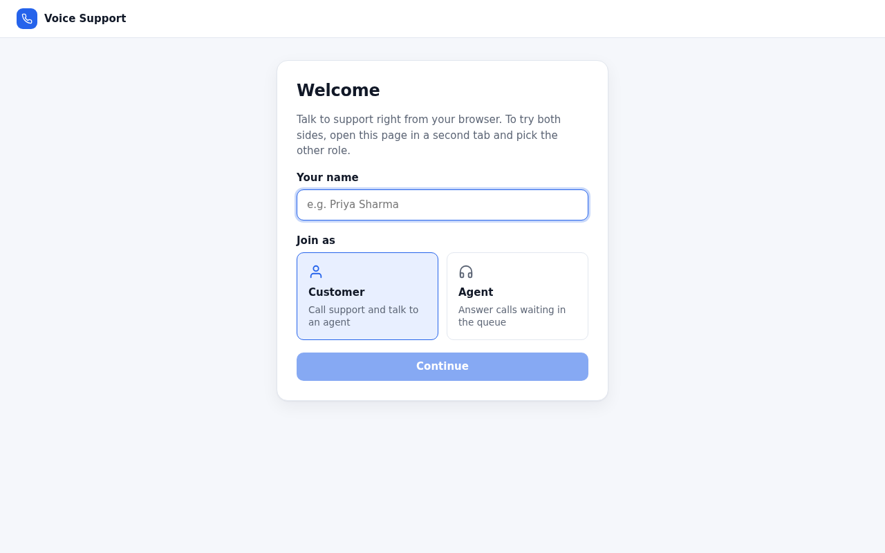 | Customer home<br>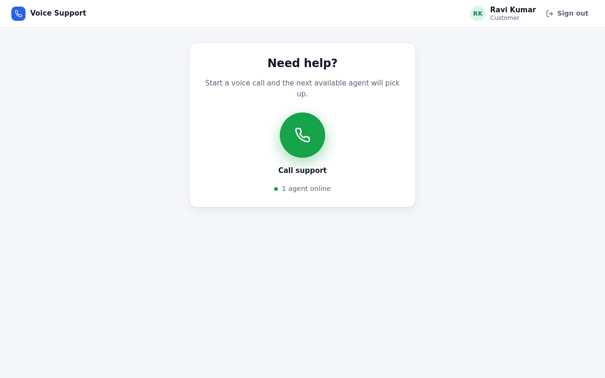 |
| Customer waiting<br>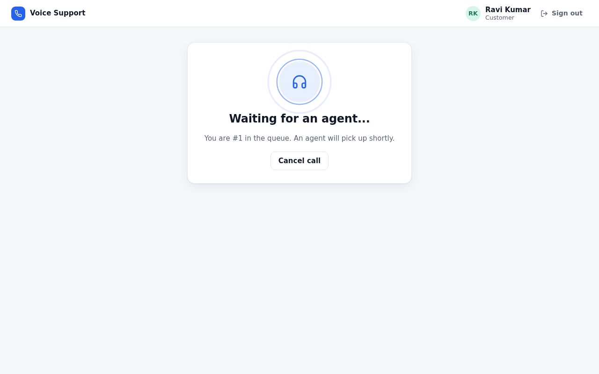 | Agent sees the call<br>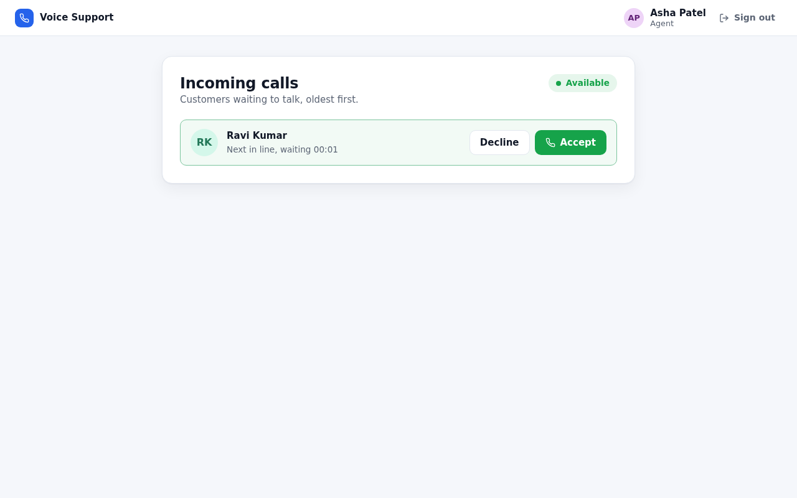 |
| Customer in a call<br>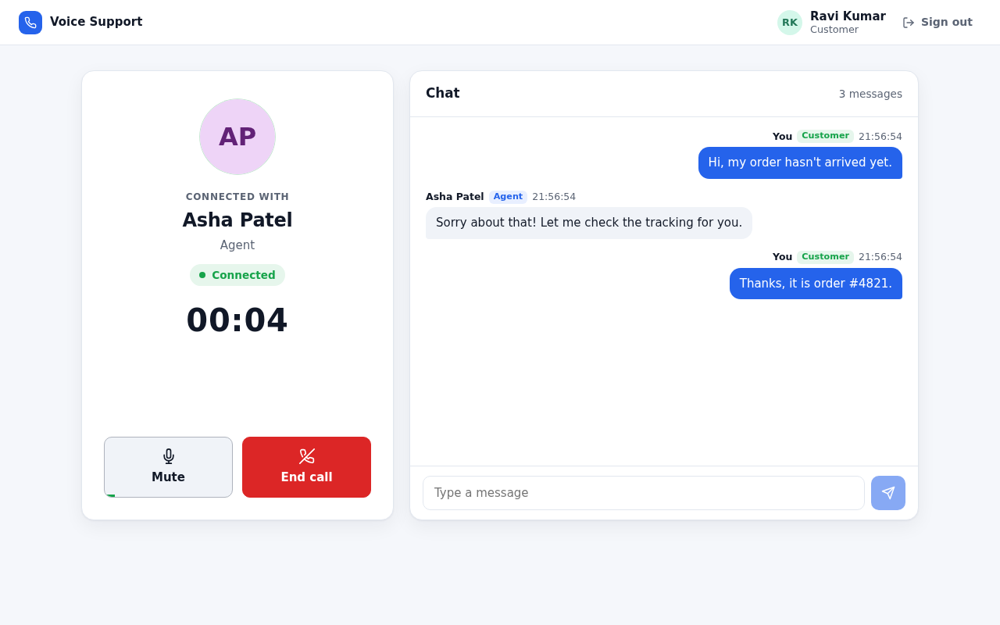 | Agent in a call, customer muted<br>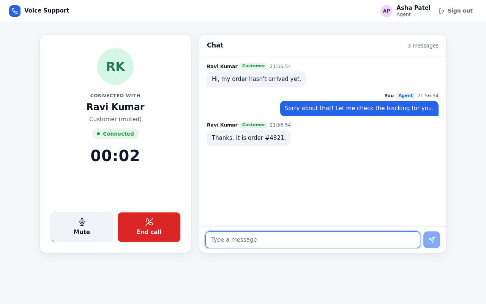 |
| Customer dropped, waiting for them to come back<br>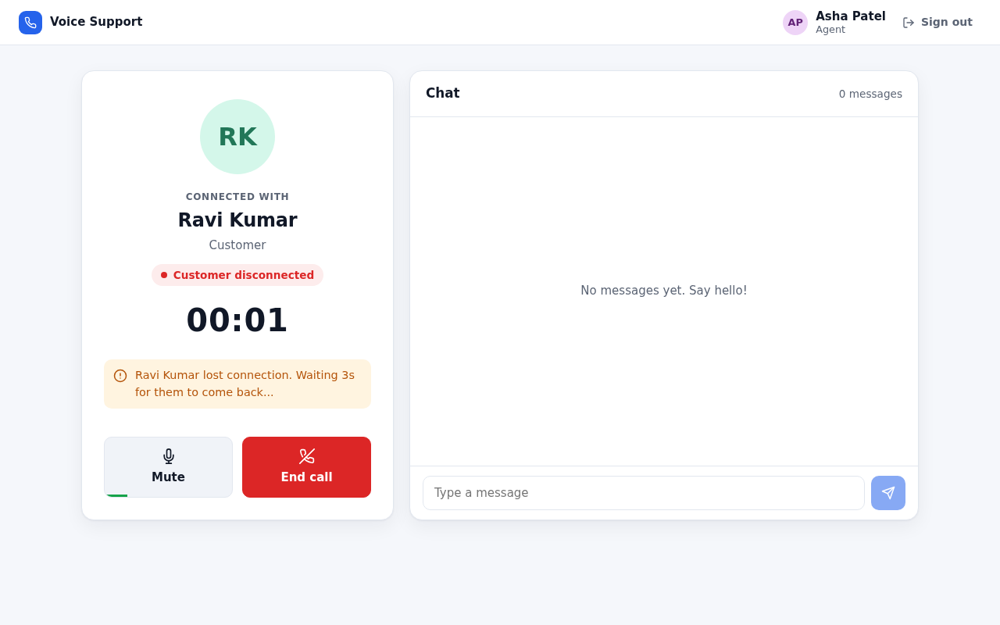 | Call ended<br>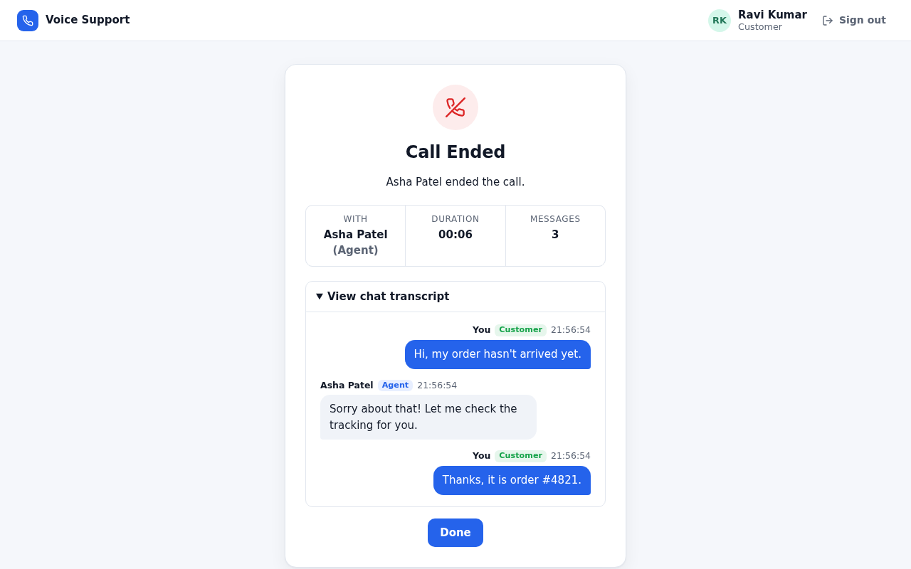 |
| Microphone blocked<br>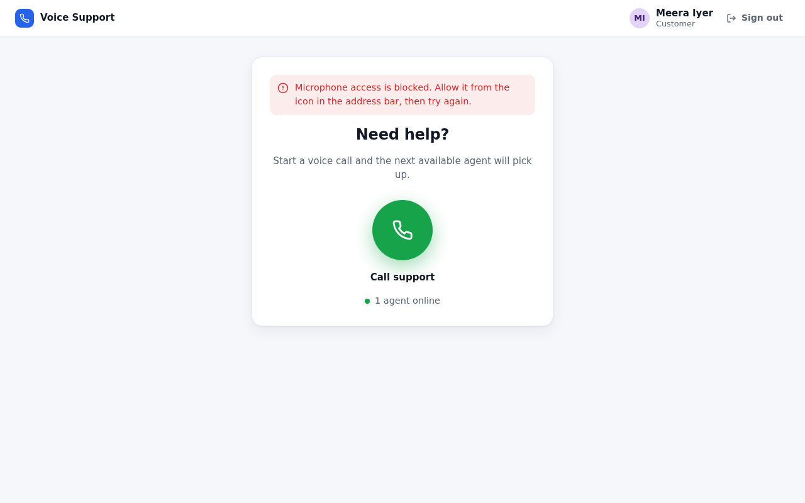 | Server connection lost<br>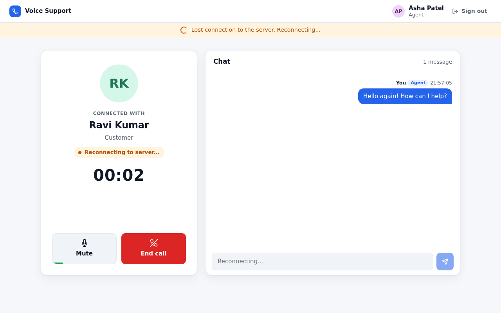 |

Mobile:

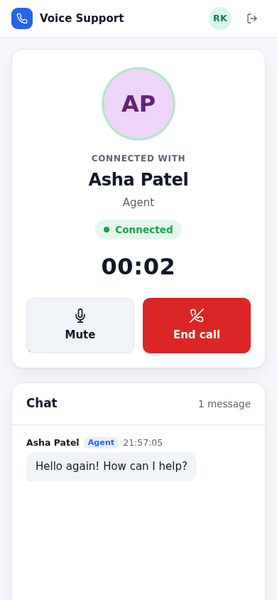
